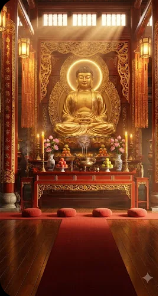
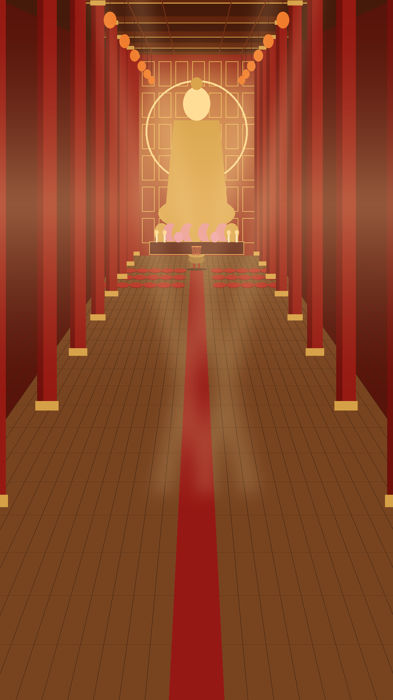

# Asset chùa ảo: prompt gen bằng Flow

Mục tiêu: **video nền thật**, còn người, khói, hiệu ứng là **lớp cắt sẵn** để code ghép theo từng người xem.

```
Lớp 4  HUD, quẻ xăm (code + ảnh khung)
Lớp 3  Hiệu ứng nền ĐEN, hoà trộn "screen": khói, hào quang, cánh sen, lấp lánh
Lớp 2  Phật tử + đạo cụ, nền XANH LÁ đã tách: quỳ, lạy, đứng; mõ, chuông, ống xăm
Lớp 1  Video nền chánh điện lặp vô hạn (không có người)
```

## 1 vibe duy nhất: dán khối STYLE vào CUỐI mọi prompt

Mọi file dùng chung **một kiểu ánh sáng, một bảng màu, một ống kính**. Đây là chánh điện trong nhà nên lúc nào cũng sáng ấm, không có ngày hay đêm, không có tông lạnh.

**STYLE-SCENE**: dùng cho nền (mục A)

```
Style: photorealistic cinematic interior photograph. Always warm golden light, about 3000K, like soft late-afternoon sun through high temple windows mixed with candlelight. A gentle golden haze of incense in the air. Palette strictly: deep lacquer red, burnished gold, warm teak brown, soft cream; no blue, no green, no cold tones, no daylight white. Soft contrast, glowing highlights, no harsh shadows. Wide-angle 20mm lens from a high vantage point, deep focus, everything sharp, subtle film grain, high detail. No people, no text, no letters, no watermark, no logo, no frame.
```

**STYLE-CUTOUT**: dùng cho Phật tử và đạo cụ (mục C, D). Cùng ánh sáng, nhưng nền xanh để tách

```
Style: photorealistic, lit to match a warm golden Buddhist temple hall: warm 3000K golden key light from the front-top, soft warm fill, gentle golden rim light on edges; palette of deep lacquer red, burnished gold, warm teak brown, soft cream, muted grey-blue robes. High-angle view from behind and above (about 40 degrees downward), deep focus, high detail, sharp clean edges. Flat solid pure green chroma key background #00FF00, evenly lit, no shadow on the background, no floor, no other objects, no text, no watermark.
```

**STYLE-FX**: dùng cho hiệu ứng (mục B)

```
Style: photorealistic visual effect element, warm golden-cream color (about 3000K), soft and elegant, high detail. Pure black background #000000, nothing else in frame, static camera, seamless loop, no text, no watermark.
```

## Ảnh tham chiếu gốc (vibe chuẩn)



`assets/ref/ref-vibe.png`: lấy **màu và ánh sáng** từ ảnh này (Phật vàng có hào quang, vách sơn son thếp vàng, cột đỏ, đèn lồng, ánh chiều vàng ấm xuyên cửa sổ). **Không lấy bố cục**: góc máy và độ rộng theo prompt A1 (đại điện, nhìn từ trên cao, không bồ đoàn).

Cách dùng trong Flow: ở **mọi** lần gen (ảnh lẫn video), kéo ảnh này vào **Ingredients / ảnh tham chiếu** và thêm một câu vào đầu prompt:

- Nền, hiệu ứng: `Match the lighting, color palette and mood of the reference image, but follow the camera angle and scale described below.`
- Phật tử, đạo cụ (nền xanh): `Match the warm golden lighting and color palette of the reference image, but place the subject on a flat pure green background (do not copy the temple).`

> Ảnh trong thư mục đang là bản cắt nhỏ từ ảnh chụp màn hình. Anh tải **bản gốc độ phân giải cao** của ảnh này từ Flow rồi lưu đè vào `assets/ref/ref-vibe.png`, dùng làm tham chiếu sẽ chuẩn hơn. Ảnh ghép 3 bản để so sánh: `assets/ref/ref-flow-3-ban.png`.

## Quy tắc chung

- **Khung dọc 9:16**, 1080p nếu có. Video dùng Veo 3.1 (Quality). Ảnh dùng Nano Banana hoặc Imagen.
- **Máy quay đứng yên tuyệt đối** (static, locked-off): không pan, không zoom.
- Video lặp: dùng **Frames to Video** với **khung đầu = khung cuối = cùng một ảnh**.
- Gen nhiều bản rồi chọn. Bản nào lệch tông (ngả xanh, ngả trắng, có chữ) thì bỏ.
- Khi đã có `bg-key.png` ưng ý thì thêm nó làm ảnh tham chiếu thứ hai bên cạnh `ref-vibe.png`.
- Gen xong thả file vào `themes/chua/assets/raw/`, đúng tên ở cột **File**. Em sẽ tách nền, cắt và đo lại vị trí.

---

## A. Nền chánh điện

### A1 · Ảnh khung chính → `bg-key.png` (ảnh 9:16)

**Cách 1 (khuyên dùng): render từ bản phác bố cục do code vẽ.** Bố cục khớp đúng toạ độ code dùng để đặt người.



`assets/ref/layout-guide.png`: **bản phác duy nhất**, đưa thẳng cho Flow. Gồm: đại điện nhìn từ cao, tượng Phật có hào quang, bàn thờ, **đỉnh hương** trên thảm ngay trước bàn thờ (chỗ dâng hương), **3 hàng nệm nhỏ** sát bàn thờ (người tặng quà được mời lên), phần sàn còn lại để trống (code đặt người quỳ), dưới cùng là khu HUD.

Dùng chức năng sửa ảnh (Nano Banana / Imagen edit), đưa **`layout-guide.png`** làm ảnh chính, **`ref-vibe.png`** làm ảnh tham chiếu:

```
Turn this layout sketch into a photorealistic photograph of an enormous Vietnamese Buddhist temple main hall. Keep EXACTLY the same composition, camera angle, perspective, sizes and positions of everything: the vanishing point, the back altar wall, the giant golden seated Buddha with halo, the altar table, the bronze tripod incense censer standing on the carpet in front of the altar, the three rows of small round red meditation cushions near the altar, the side pillars, the narrow red carpet down the center, and the vast empty wooden floor below.
Replace the flat shapes with real materials: carved red lacquer wall with gold relief panels, a finely sculpted golden Amitabha Buddha on a lotus throne, a red-gold lacquered altar with lotus flowers, fruit offerings and lit candles, a bronze tripod censer with a bundle of lit incense sticks, small red embroidered meditation cushions, polished warm teak floorboards with soft reflections, a red woven carpet runner, red pillars with gold carvings, warm lanterns.
Match the lighting and color palette of the reference image. Keep the same number of cushions, do not make them bigger. No people anywhere, the rest of the floor stays completely empty.
```
→ dán **STYLE-SCENE** vào cuối. Muốn sửa bố cục (rộng hơn, cột thưa hơn…) thì báo em sửa bản phác: `uv run --no-project --with pillow python themes/chua/tools/make-layout.py`.

**Cách 2: chỉ dùng chữ** (khi không muốn dùng bản phác):

Cảm giác cần có: **một đại điện mênh mông nhìn từ trên cao**, như đứng trên gác lửng cuối điện nhìn xuống. Tượng Phật lớn nhưng ở xa. Sàn gỗ trải dài, đủ chỗ cho **hàng trăm người quỳ** (code vẽ người, ảnh để sàn trống). **Không có bồ đoàn**, không có đồ vật to ở sàn làm phá tỉ lệ.

```
Vertical 9:16 high-angle establishing shot of an ENORMOUS, vast Vietnamese Buddhist temple main hall, perfectly symmetrical, one-point perspective, a sense of huge scale and depth.
The camera is high up on a balcony at the very back of the hall, about 8 meters above the floor, looking down the full length of the hall at roughly 35 degrees downward.
Far away at the top of the frame: a giant golden seated Amitabha Buddha statue, about ten meters tall, on a lotus throne with a softly glowing golden halo, in front of a towering carved red-and-gold lacquered altar wall, flanked by rows of tall red lacquered pillars with golden carvings receding into the distance, hanging red-gold silk banners and many small warm lanterns along the ceiling beams.
In front of the statue, small in the distance: a long red-gold altar with a bronze incense burner in the exact center, lotus flowers and candles.
The lower two thirds of the frame: a vast, completely EMPTY polished warm teak wooden floor stretching from the bottom of the frame to the altar, large enough for hundreds of kneeling worshippers, with one narrow red carpet runner down the exact center. No cushions, no mats, no furniture, no objects on the floor.
Everything looks small and far because the hall is so large.
```
→ dán **STYLE-SCENE** vào cuối.

> Mẹo: muốn tỉ lệ đúng hơn thì thêm vào cuối prompt, trước STYLE: `For scale only: the floor would fit about 20 rows of 15 kneeling people each.` Nếu ảnh ra có người thì bỏ câu này.

### A2 · Video nền lặp → `bg-loop.mp4` (Frames to Video, đầu = cuối = A1, 8 giây)

```
Static locked-off camera, absolutely no camera movement; the hall stays exactly the same.
Only subtle ambient motion: candle flames flicker gently, thin incense smoke rises slowly from the burner and drifts, golden light rays shimmer softly through the haze, tiny dust particles float in the light, silk banners sway very slightly, the Buddha halo glows softly.
No people, no new objects, calm and serene.
```
→ dán **STYLE-SCENE** vào cuối.

---

## B. Hiệu ứng nền đen

Tất cả: **Text to Video, 9:16, 8 giây**, dán **STYLE-FX** vào cuối. Code hoà trộn kiểu "screen" nên phần đen tự biến mất.

| File | Dùng khi | Prompt |
|---|---|---|
| `fx-smoke.mp4` | khói hương thường trực | `Thin elegant wisps of warm cream incense smoke rising slowly from a single point at the bottom center, curling and dissolving upward` |
| `fx-smoke-burst.mp4` | dâng hương | `A rich burst of warm cream incense smoke rising from the bottom center, many curling ribbons spreading upward then fading` |
| `fx-halo.mp4` | quà lớn, đại lễ | `A radiant golden Buddhist halo of light expanding from the center: concentric golden rings and soft rays bursting outward, glowing, then gently fading` |
| `fx-rays.mp4` | đạt mục tiêu, ban phước | `Soft golden god rays streaming down from the top center, slowly shimmering, floating golden dust particles` |
| `fx-petals.mp4` | dâng hoa sen | `Soft pink lotus petals with warm golden light falling slowly and twirling from the top to the bottom, a few at a time` |
| `fx-sparkle.mp4` | lễ Phật, lên danh hiệu | `Tiny warm golden sparkles and glowing particles swirling gently upward in a column from the bottom center` |
| `fx-lotus-bloom.mp4` | dâng hoa sen lớn | `A single glowing pink-and-gold lotus flower blooming open in the center, petals unfolding, emitting soft golden light` |

---

## C. Phật tử (nền xanh, em tách thành nhân vật)

Mỗi nhân vật cần **3 thứ**. Dùng **Ingredients** hoặc dùng ảnh C1 làm khung đầu để giữ đúng một người.

- **C1 · quỳ yên** (ảnh) → `devotee-<n>-kneel.png`
- **C2 · lạy** (Frames to Video, đầu = cuối = C1, 6–8 giây) → `devotee-<n>-bow.mp4`
- **C3 · đứng chắp tay** (ảnh) → `devotee-<n>-stand.png`

C1 (thay phần *[nhân vật]*), dán **STYLE-CUTOUT** vào cuối:

```
Full body shot of a Vietnamese Buddhist lay devotee seen from BEHIND, kneeling on the floor facing away from the camera, palms pressed together in prayer at the chest, wearing a traditional muted grey-blue Buddhist lay robe (áo tràng lam), [nhân vật]. Camera high above and behind the person looking down at about 40 degrees, matching a balcony view of a large hall, the whole body visible with generous empty margin around it, centered.
```

C2 (lạy), dán **STYLE-CUTOUT** vào cuối:

```
Static locked-off camera. The same person, still seen from behind, slowly bows forward to touch the forehead to the floor with palms together, pauses, then rises back to the upright kneeling prayer position. Calm, reverent, smooth natural motion. No camera movement.
```

C3 (đứng): giống C1 nhưng đổi `kneeling on the floor` thành `standing upright`.

6 nhân vật (thay vào *[nhân vật]*):

1. `an elderly woman with grey hair in a neat low bun`
2. `a middle-aged woman with black hair tied in a bun`
3. `a young woman with long black hair tied in a low ponytail`
4. `an elderly man with short white hair`
5. `a middle-aged man with short black hair`
6. `a young man with short black hair`

Gen được ít hơn thì ưu tiên 1, 2, 5. Code sẽ lật trái phải và đổi tông áo nhẹ để đám đông không bị lặp.

---

## D. Đạo cụ (nền xanh)

Dán **STYLE-CUTOUT** vào cuối mỗi prompt. (Nệm và đỉnh hương đã có sẵn trong ảnh nền, không cần gen riêng.)

| File | Prompt |
|---|---|
| `mo.png` | `A traditional Vietnamese Buddhist wooden fish drum (mõ) carved in the shape of a round fish, dark red lacquer with gold details, resting on a small embroidered red cushion, three-quarter view, isolated and centered` |
| `mo-dui.png` | `A single wooden mallet for a Buddhist wooden fish drum, round padded red cloth head, dark wooden handle, lying diagonally, isolated and centered` |
| `chuong.png` | `A bronze Buddhist bowl bell (chuông gia trì) on a round red embroidered cushion with a wooden striker beside it, three-quarter view, isolated and centered` |
| `ong-xam.png` | `A traditional bamboo fortune stick cylinder (ống xăm) full of thin red-tipped bamboo fortune sticks, red lacquer band with gold ornament, front view, isolated and centered` |
| `que-xam.png` | `A single thin bamboo fortune stick with a red painted tip, vertical, isolated and centered` |
| `den-sen.png` | `A small lotus-shaped oil lamp with pink and gold petals and a warm glowing flame in the center, isolated and centered` |

**(Tuỳ chọn) `ong-xam-lac.mp4`** (Frames to Video, đầu = `ong-xam.png`), dán STYLE-CUTOUT:
`Static camera. Two hands hold the bamboo fortune cylinder and shake it rhythmically, the sticks rattle, one stick slowly slides out and falls forward.`

---

## E. Khung giao diện

Dán khối sau vào cuối: `Warm golden 3000K lighting, palette of deep lacquer red, burnished gold, warm teak brown, soft cream. Flat front view, full frame, no text, no watermark.`

| File | Tỉ lệ | Prompt |
|---|---|---|
| `que-card.png` | 3:4 | `An empty traditional Vietnamese fortune slip of aged handmade dó paper in soft cream, with a deep red and gold ornamental border and a small red lotus seal at the top, blank center for text` |
| `panel.png` | 16:9 | `An empty ornamental frame panel of deep red lacquer with gold Buddhist cloud and lotus carvings on the border, blank dark red center` |

---

## Âm thanh

Nhạc nền và tiếng tụng dùng **file thu âm thật** (code không tự tạo giai điệu). Thả `.mp3` vào `assets/music/`, rồi chọn "Nhạc từ file" trong bảng điều khiển. Chỉ dùng nhạc miễn phí bản quyền hoặc nhạc anh có quyền dùng.

## Thứ tự gen gợi ý

1. **A1** (hoặc sửa ảnh bên phải anh đã có) → **A2**.
2. **C** cho nhân vật 1, 2, 5.
3. **B**: `fx-smoke`, `fx-halo`, `fx-petals`.
4. **D**: `mo`, `ong-xam`, `que-card`.
5. Phần còn lại.
